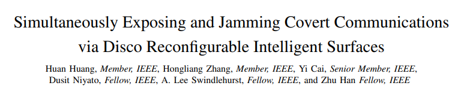
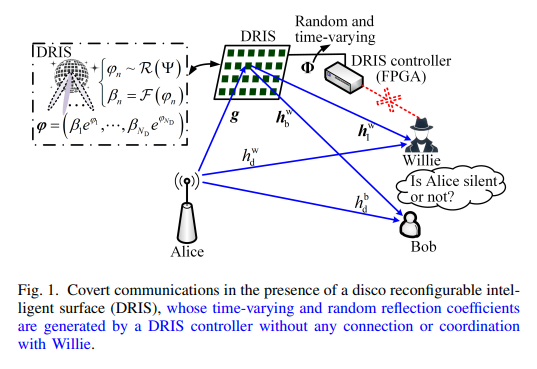
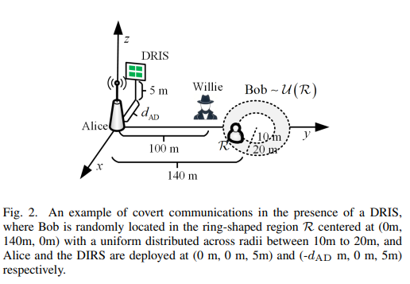
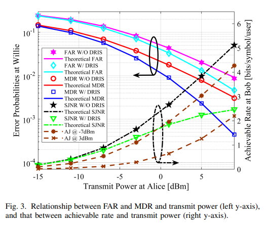
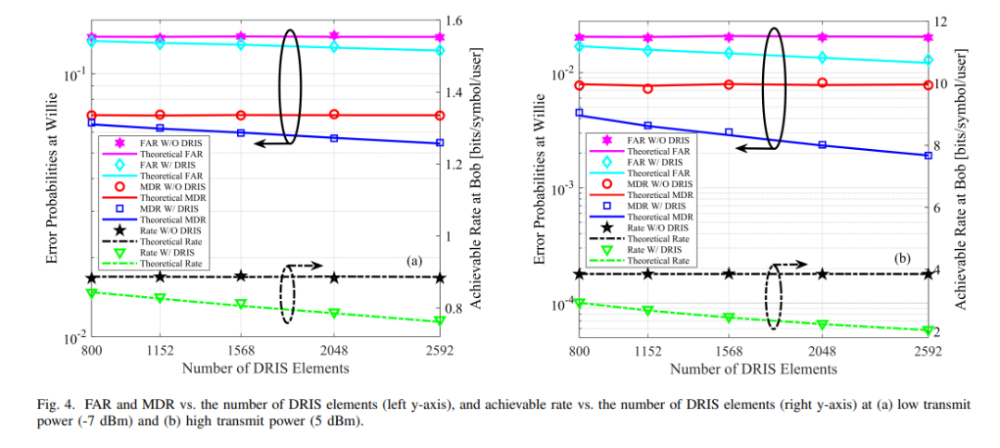
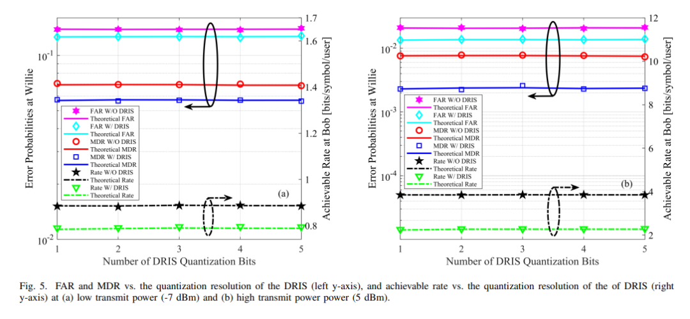
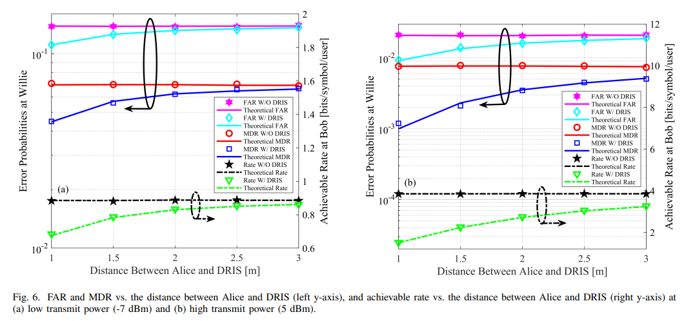
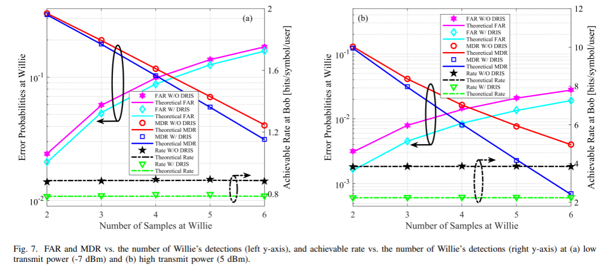

# [RIS+Hidden Communication+Anti-Interference] Smart Ultra-Surface: Precisely Break Through Hidden Communication with Passive Interference[with MATLAB Code]

Smart Ultra-Surface Utilization for Precisely Identifying and Disrupting Covert Communications
The study explores the use of a reconfigurable smart ultra-surface (DRIS) to simultaneously identify and disrupt covert communications.
Abstract: Compared to cryptographic and physical layer security technologies, covert communications offer stronger privacy protection. However, previous research on covert communications has assumed the channel mutual information is constant or nearly constant over the coherence time. This paper investigates covert communication issues in scenarios where the monitor Weli deploys a DRIS: The ultra-surface's reflection coefficient exhibits randomness and time-variability, resembling a "Disco Ball," generating time-varying full-passive jamming (FPJ), rendering the channel mutual information assumption invalid. This DRIS does not require access to Bob's channel information nor additional jamming power, capable of both interfering with Alice and Bob's covert transmission and reducing Weli's detection error probability. To quantify the impact of the DRIS on covert communications, this paper first devised a set of rules for detecting time-varying full-passive jamming by Weli when equipped with the DRIS; subsequently, false alarm rate (FAR) and miss rate (MDR) were defined as evaluation metrics for Weli's detection performance, while signal-to-interference-plus-noise ratio (SJNR) was defined as a performance metric for covert transmission between Alice and Bob. Based on the designed detection rules, this paper deduced the detection threshold for Weli to determine whether Alice and Bob are communicating, theoretically analyzed Weli's FAR, MDR, and Bob's SJNR, thereby revealing the unique characteristics of full-passive jamming in covert communications through the DRIS. Finally, numerical simulations validated the effectiveness of the theoretical analysis and assessed the specific impact of the DRIS on covert communications.
Keywords: Covert Communication; Smart Reflective Surface; Signal Detection; Physical Layer Security; Channel Aging
The broadcast and superposition characteristics of wireless channels make wireless systems inherently vulnerable to various malicious attacks, a problem that is particularly prominent in the era of the Internet of Things (IoT). In IoT, data transmitted often contains sensitive personal information such as health and location, which is crucial in scenarios where communication confidentiality is strictly required, such as government and military sectors. Consequently, research related to transmission security and privacy protection has seen rapid development. Covert communication, also known as low detection probability communication, aims to conceal the transmission of communication within environmental noise, thereby avoiding detection by adversarial monitoring parties.
Compared to cryptography and physical layer security technologies, covert communication can achieve higher levels of privacy protection. This is because if the eavesdropper does not detect the presence of the communication transmission, they will not attempt to decode the information contained in the signal. Research has established a fundamental conclusion for covert communication: even in the nth use of an additive Gaussian white noise channel, it is possible to transmit bits of data while achieving arbitrary low detection probability, where the non-asymptotic tight upper bound is; whereas if the lower bound of the noise power is known, up to at most bit of data can be transmitted, with the asymptotic tight upper bound.
Following this foundational research, subsequent studies have introduced technologies such as non-orthogonal multiple access and turbo coding to enhance the effectiveness of covert communication while maintaining transmission performance. Some research has explored methods to increase the degree of power fluctuation by introducing jammers or adding artificial noise, thereby increasing the difficulty of Weil's accurate decision-making. Additionally, studies have confirmed that the use of relays can further expand power fluctuations, thereby complicating Weil's detection. Scholars have also utilized the variations in received power caused by small-scale fading for covert communication.
In summary, whether it is inherent characteristics of wireless channels such as noise and fading, or factors introduced by both parties in communication, such as relaying, encoding, and interference, all can be effectively avoided by Alice's signals through the uncertainty of wireless communication channels.
Reconfigurable Intelligent Surfaces (RIS) are key technologies for enhancing wireless communication performance. They consist of a large number of adjustable reflection coefficient elements, which can be easily programmed to adjust the unit's reflection coefficient through simple programmable diodes. Integrating RIS into wireless networks can significantly improve system performance without significantly increasing power consumption and cost. Existing research has explored their application in concealed communication, focusing on systems using non-orthogonal multiple access, artificial noise, variable prior probability limited block length coding, or drones, where one or more RIS can be used to achieve concealed communication.
However, all existing studies involving or not involving RIS in concealed communication assume the immutability of the time-division duplex wireless channel's reciprocity. Although this assumption is generally reasonable, it is broken when there are time-varying Discrete Orthogonal Frequency-Division Multiplexing (DOST) RIS or RIS with non-reciprocal connections between units. Existing research further proposes that by utilizing DOST RIS, an all-passive interference attack can be launched without the need for legitimate user channel information or additional interference power. The reflection coefficients of DOST RIS have both time-varying and random characteristics, similar to "Discrete Orthogonal Frequency-Division Multiplexing (DOST) balls," introducing active channel aging. Even within the coherence time of the channel, the reciprocity of the time-division duplex channel will fail; some studies also use such supersurfaces to disrupt the key agreement generation based on channel reciprocity.
This paper investigates a novel approach to breaking the mutual incoherence of concealed communication channels using Discrete Interval Reconfigurable Intelligent Surfaces (DRIS). The core contributions are as follows:
1. A concealed communication model under DRIS scenarios is constructed, where the random time-varying reflection coefficients of the supersurface generate all-passive interference that does not require Alice-Bob channel information or additional interference power, and can both affect their concealed communication and reduce Weil's detection error probability.
2. To characterize the impact of this all-passive interference, a Weil's detection rule is designed, using false alarm rate and missed detection rate as performance indicators for Weil's detection, and signal-to-interference-plus-noise ratio (SINR) as an indicator for the performance of Alice-Bob's concealed communication.
3. To quantify the impact of time-varying all-passive interference, firstly, the statistical characteristics of the channel under DRIS influence are derived, then based on these characteristics and the designed detection rule, a detection threshold for Weil's decision on whether communication has occurred is determined, which leads to the closed-form expressions of Weil's false alarm rate and missed detection rate, and an asymptotic analysis of the SINR for Bob's side is conducted. Finally, the accuracy of theoretical analysis is verified through simulations.
4. Based on detailed theoretical analysis, it reveals the unique characteristics of all-passive interference in concealed communication under DRIS, such as not only reducing Weil's detection error probability but also significantly interfering with Alice and Bob's communication even if Weil misses detections. Increasing Alice's transmitting power cannot effectively improve communication performance but instead exacerbates the impact of all-passive interference and increases the risk of being detected by Weil. Using only 1-bit quantization of reflection coefficients, DRIS alone is sufficient to enhance Weil's detection precision and degrade Alice and Bob's communication performance.
System and Channel Modeling: Construct a covert communication system with Alice (sender), Bob (receiver), Willie (monitor), and Disco reconfigurable smart metasurface. The metasurface is controlled by an FPGA controller, with its reflection coefficients randomly time-varying and quantized in b bits. Establish reception signal models at both the Willie and Bob ends, distinguishing direct link signals from those transmitted through the Disco reconfigurable smart metasurface. Simultaneously, construct channel models for each link based on far-field and near-field assumptions, clarifying the Rayleigh fading characteristics of the Alice-metasurface link, as well as the complex Gaussian distribution characteristics of other direct links and metasurface-receiver channels.
2  
Design Monitoring Rules: To address the issue of distorted channel reciprocity and non-independent identically distributed (i.i.d.) samples caused by the Ditherable Reconfigurable Smart Ultrasurface, abandon traditional total power detection statistics, propose a decision region based on the squares of individual samples, and design time-varying detection thresholds for each sample using likelihood ratio tests; define false alarm rate (false communication occurrence) and missed rate (missed communication occurrence) as performance indicators, while considering signal-to-interference-plus-noise ratio (SINR) as a communication performance metric, quantifying the interference effect of the ultrasurface on communication.
3  
Asymptotic Theoretical Analysis: First, we derive the statistical characteristics of the statistical link channel for the disco reconfigurable smart metasurface link. We prove that as the number of metasurface elements approaches infinity, the channel converges to a complex Gaussian distribution. Based on this derivation, we derive the probability density function of the received signal at the Will's end and determine an explicit expression for the optimal detection threshold. Further, we derive closed-form expressions for false alarm rate and missed detection rate, analyzing the impact of the metasurface on detection performance. Simultaneously, we perform an asymptotic analysis of the signal-to-interference-plus-noise ratio (SINR) at Bob's end, derive its asymptotic convergence expression, and reveal the regularity of the metasurface's role in communication performance.
4  
Perform numerical simulation verification: Set up simulation parameters that comply with the 3GPP propagation model, construct specific spatial deployment scenarios, and verify factors such as Alice's transmit power, Disco reconfigurable smart metasurface unit count, reflection coefficient quantization accuracy, Alice-metasurface distance, and Weil detection sample count. Impact on false alarm rate, missed detection rate, and Bobby end reachability rate; At the same time, it compares completely passive interference with traditional active interference to highlight the technical advantages of Disco's reconfigurable intelligent metasurface.
Conclusion This paper proposes a novel method to enhance the ability of monitoring for Weili in detecting Alice and Bob's covert communication, while also interfering with this covert communication. This method is based on Disco reconfigurable smart metasurface without needing to acquire Alice-Bob channel information or consuming active interference power. Through theoretical analysis and numerical simulation, the following core conclusions can be drawn:
1  
A reconfigurable smart metasurface with random time-varying reflection coefficients, which can introduce all-passage noise in concealed communication. If Willy's detection rules are adapted to this time-varying interference, the metasurface can not only reduce its false alarm rate and missed detection rate but also significantly interfere with Alice and Bob's covert transmission even if Willy misses.
2  
Due to the presence of fully passive interference from Disco reconfigurable smart metasurfaces, enhancing Alice's transmit power cannot effectively improve their communication performance. Moreover, an increased transmit power will enhance Willy's detection accuracy, while also exacerbating the passive interference on Alice and Bob's covert communication.
3  
A disco reconfigurable smart metasurface equipped with only 1-bit quantized reflection coefficients and a large number of reflection units is sufficient to significantly enhance Weil's detection accuracy, while degrading the concealed communication performance between Alice and Bob. Additionally, Weil must deploy this metasurface as close to Alice as possible to effectively monitor their communication, maximizing the effectiveness of passive interference attacks.
This study demonstrates that unauthorized deployment of intelligent metasurfaces poses a significant threat to covert communication, even without channel information or additional interference power, highlighting an urgent concern in this field. Therefore, concealed communication systems need to study corresponding countermeasures, such as signal classification based on artificial intelligence, anomaly detection technology, or adaptive beamforming technology.

## Images

<!-- PAYMENT_BLOCK -->

## Get this dataset

- Payment link (Stripe): [Buy now](https://buy.stripe.com/3cs8yP7sY87d0vu9AB)
- Payment QR code: 

<!-- /PAYMENT_BLOCK -->
